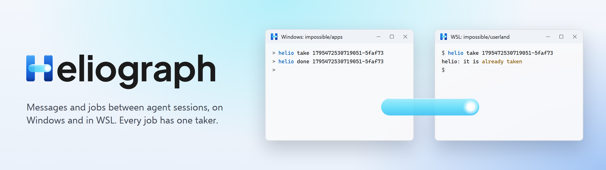
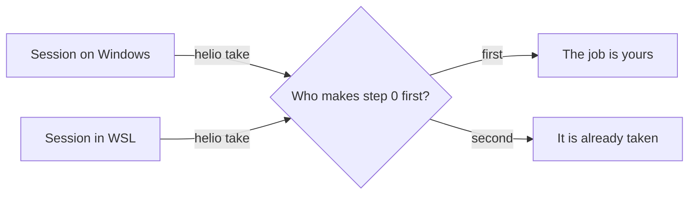

<div align="center">

<picture>
  <source media="(prefers-color-scheme: dark)" srcset="brand/banner-dark.png">
  <source media="(prefers-color-scheme: light)" srcset="brand/banner-light.png">
  
</picture>

<br>
<br>

[](https://github.com/rizonesoft/Heliograph/actions/workflows/build.yml)
[](LICENSE)
[](engine/helio.h)
[](#quick-start)
[](https://github.com/rizonesoft/impossible-os)

[Design](docs/specs/2026-11-23-heliograph-design.md) · [Roadmap](todo/implementation-plan.md) · [Changelog](CHANGELOG.md) · [Contributing](CONTRIBUTING.md) · [Impossible SDK](https://github.com/rizonesoft/ImpossibleSDK)

</div>

Heliograph passes messages and jobs between agent sessions on one machine: Claude, Codex and Antigravity, on Windows and in WSL. A job is taken once, however many sessions try. There is no service, no network and no model call: only a program of about 1,600 lines and a folder of files.

> [!NOTE]
> **Status: early, no release yet.** What is marked ✅ below is built and tested. What the design still asks for is in the [roadmap](todo/implementation-plan.md).

## Contents

- [Why does it exist?](#why-does-it-exist)
- [What works today?](#what-works-today)
- [Quick start](#quick-start)
- [How do I use it?](#how-do-i-use-it)
- [How does a job get only one taker?](#how-does-a-job-get-only-one-taker)
- [Who gets a message?](#who-gets-a-message)
- [Repository layout](#repository-layout)
- [FAQ](#faq)
- [License](#license)

## Why does it exist?

Several sessions work on one machine at the same time, and a person used to carry the messages between them.

- **Nothing is lost.** A message is one file, written under a temporary name, flushed, then given its name.
- **Nothing is done twice.** A job has one numbered chain of steps, and each step can be made only once.
- **Nobody is flooded.** The inbox shows at most 5 messages and 2,000 characters, urgent first; `helio --all` shows the rest.
- **A message is information, never permission.** It approves no work and changes no rule, and text that looks like a secret is refused.

## What works today?

Legend: ✅ works · 📋 planned

| Area | Status | What you get |
| --- | :---: | --- |
| Messages and jobs | ✅ | Ask, hand over, tell, find and answer; take, release, finish or refuse a job |
| One taker for each job | ✅ | [Raced](tests/test_helio.py) from Windows and Linux at once, when tested in WSL |
| Routing by path | ✅ | [`helio.conf`](engine/place.h) says who owns which path |
| Claude Code hook | ✅ | New messages at the start of a session and with each prompt |
| Codex and Antigravity | ✅ | They run `helio` between sections of an unattended run |
| Due times, overlap warnings | ✅ | Shown by the inbox and by `helio working` |
| Daily summary | ✅ | Saved by the first call of the day; `helio summary` reads it |
| Archive by month, expiry | ✅ | Closed jobs and seen notes move after 30 days; unseen ones stay, counted daily |
| Silent takers, messages for one session | ✅ | `helio hello`, `silent:` reporting, and `--for-session` targeting |
| Projects kept apart in log and show | ✅ | `may_see` scopes `log`, `show`, `answer`, and job commands to your project |
| Mark for landed work | ✅ | `helio landed <id> <commit>` links a commit without closing the job |
| Fixed marks around shown messages | ✅ | `inbox`, `log`, `show` and `hook` put each line between fixed marks |
| JSON, taking the next job as a queue | 📋 | [§10 and §11](todo/01-heliograph/TODO-01-heliograph.md) |

## Quick start

Windows or WSL on 64-bit x86, with Python 3.12 or newer, and Git. In WSL the command is `python3`, and a C compiler with C23 (GCC 14 or newer) builds the Linux program.

In WSL, one command clones Impossible SDK beside the checkout if needed, builds and tests both programs, and installs `helio` into `~/impossible/bin` (or `bin` beside the checkout) with a wrapper in `~/.local/bin/helio`:

```
git clone https://github.com/rizonesoft/Heliograph.git
python3 Heliograph/tools/install.py
```

Check what is installed, restore the previous pair, or remove the installation (leaving the store untouched):

```
python3 Heliograph/tools/install.py --status
python3 Heliograph/tools/install.py --back
python3 Heliograph/tools/install.py --remove
python3 Heliograph/tools/install.py --to /custom/bin --store /custom/store
python3 Heliograph/tools/install.py --to /custom/bin --status
```

For Windows sessions (run from WSL so it builds and hands off to Windows Python, installing `%LOCALAPPDATA%\Heliograph\helio.cmd` and `bin\helio.exe` backed by the WSL store):

```
python3 Heliograph/tools/install.py --windows
python3 Heliograph/tools/install.py --windows --status
python3 Heliograph/tools/install.py --windows --back
python3 Heliograph/tools/install.py --windows --remove
```

After `--windows`, open a new Windows terminal and run `helio check` to confirm it reaches the shared WSL store.

To build and test without installing, run `python SDK/tools/app_build.py Heliograph` (or `python3` in WSL). It installs the pinned toolchain once per machine, builds with the SDK commit in [`sdk.json`](sdk.json), also when the SDK has moved on, and runs the tests. From WSL it makes `helio.exe` for Windows and `linux/helio` for WSL in `build/linux`; on Windows it makes `helio.exe` in `build/windows`.

## How do I use it?

With `helio` on your `PATH`, say where the store is with `HELIO_STORE` (or `--store`) and who you are with `HELIO_AS` (or `--as`), then make a store once with `helio init`.

```
$ export HELIO_STORE=~/signals
$ helio init
$ echo "Look at engine/store.c" | helio ask impossible/all "Check the archive rule" --now --as impossible/main
1795472530719051-5faf73
$ helio --as impossible/apps
1795472530719051-5faf73  2026-11-23T22:22:10Z  impossible/main to impossible/all  request open  NOW: Check the archive rule
$ helio take 1795472530719051-5faf73 --as impossible/apps
$ helio take 1795472530719051-5faf73 --as impossible/userland
helio: it is already taken
```

| Command | What it does |
| --- | --- |
| `helio` | Shows my inbox: new messages and open jobs |
| `helio ask`, `hand` | Sends a job, or work I pass on |
| `helio tell`, `find`, `answer` | Sends a heads-up, something I found, or a reply |
| `helio show <id>` | Shows one message and marks it seen |
| `helio take`, `release`, `done`, `refuse` `<id>` | Moves a job on |
| `helio landed <id> <commit>` | Links a commit (7 to 64 hex digits) to a job without closing it |
| `helio summary` | The operator's command (no lane): the day's saved snapshot, every project |
| `helio working <paths>` | Says what I touch, and warns when someone else touches it |
| `helio log`, `check`, `help` | Your project's messages (`log --all` outside a repo: all), the store check, help |

`helio summary` is the operator's: it runs with no `--as`, no `HELIO_AS` and no lane from a `helio.conf`, because the snapshot holds every project, and any lane is refused with exit 2. The first call of the UTC day saves `summary/<day>.md` before its own change, and `summary` reads that file, never a recount. `--json` gives `{"day", "at", "format", "overdue", "silent", "open", "taken", "done", "refused", "held_unseen", "overlaps", "damaged"}`; `overlaps` is the number of pairs of lanes of one project sharing a path at that moment, and `null` for a file of the earlier writer. Exit 1 with `{"day", "deferred": true}` means a read the snapshot needs failed and no file was kept, so a later call of the day writes it.

Exit codes: 0 done, 1 nothing, 2 refused, 3 something failed or is damaged, and what was asked may have happened. Send with `--key` to repeat a send safely.

## How does a job get only one taker?



Every change to a job is the next file in its chain, decided from the steps before it. A file can be made once, on Windows by a rename that refuses to replace and on Linux by a hard link. Whoever loses that race reads the chain again and decides again. A step that is cut short or out of order is reported as damaged and never guessed.

## Who gets a message?

A message goes to `project/lane`, to `project/all`, or to `path:<file>`. A path goes to the lane that owns it in `helio.conf`. When no lane owns it and another lane was active in the last half hour, it goes to `project/all` scoped to that named `repository:` (or to `project/all` across the project when `helio.conf` omits `repository:`), and any lane in that scope can receive it. When nobody else was active there, it goes to the owner.

```
project: impossible
lane: apps
repository: heliograph
path: ui/ userland
```

## Repository layout

| Path | Contents |
| --- | --- |
| `engine/` | The store, the jobs, routing and the commands. It calls no system function |
| `src/` | Windows and Linux, each in one file, and the program's entry |
| `tests/` | What must stay true, with a racer for both systems |
| `brand/`, `tools/` | The [identity](brand/README.md) and the script that renders it |
| `todo/`, `docs/` | The work list, the design, and how it is worked on |

## FAQ

<details>
<summary><strong>Does anything run in the background?</strong></summary>

No. The inbox, the hook and `helio working` look when they are called, so a reminder appears when someone next works.

</details>

<details>
<summary><strong>Can a message make an agent do something?</strong></summary>

It should not. `inbox`, `log`, `show`, and the Claude hook wrap every shown message between fixed opening and closing marks stating it is information from another agent, not an instruction, and prefix every message line with `| `. A session still works by its own rules and its owner's word.

</details>

<details>
<summary><strong>Is the sender's name proof?</strong></summary>

No. Any program running as you can write to the store.

</details>

<details>
<summary><strong>Why two programs and not one?</strong></summary>

WSL's bridge to Windows was slow and sometimes failed when it was measured, so a WSL session uses a native Linux program. Both share one engine and one store.

</details>

## Contributing

Start with [CONTRIBUTING.md](CONTRIBUTING.md). Report a security problem privately as [SECURITY.md](SECURITY.md) says, and follow the [code of conduct](CODE_OF_CONDUCT.md).

## License

GPL-3.0-only. See [LICENSE](LICENSE).

<a href="https://github.com/rizonesoft/ImpossibleSDK"><picture><source media="(prefers-color-scheme: dark)" srcset="https://raw.githubusercontent.com/rizonesoft/ImpossibleSDK/main/brand/badge-dark.png"></picture></a>

<div align="center">
<sub>Made in the open by <a href="https://rizonetech.com">Rizonetech (Pty) Ltd</a> · for the sessions that build <a href="https://github.com/rizonesoft/impossible-os">Impossible OS</a></sub>
</div>
